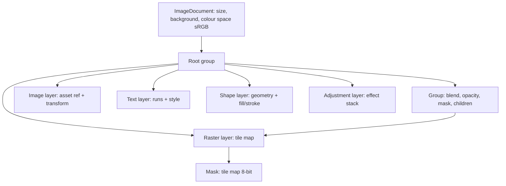

# Image editor architecture

- **Status:** Draft for owner review (2026-11-17)
- **Requirements:** IMG-1 to IMG-15, PERF-1, PERF-5. **Related:** [system architecture](system-architecture.md), [ADR-0004](../adr/0004-rendering-stack.md), [ADR-0006](../adr/0006-document-state-and-undo-redo.md), [ADR-0015](../adr/0015-raster-history-tile-deltas.md)

## 1. Scope (tier 2)
Layers, groups, masks, blend modes, text, shapes, selections, brush/eraser, non-destructive adjustment layers, crop/resize/rotate, export. Out of scope for v1:
smart objects, vector path editing, RAW, CMYK/ICC, magic wand (IMG-14).

## 2. Document model

- **Normalised storage:** `layers: Record<LayerId, Layer>` plus `children: LayerId[]` per group (ordered), so moves and reorders produce few patches ([ADR-0006](../adr/0006-document-state-and-undo-redo.md) amendment).
- **Common layer fields:** `id, name, visible, locked, opacity, blendMode, transform{x,y,scaleX,scaleY,rotation,skew}, maskId?, clipToBelow?`.
- **Layer types:**
  - *Raster:* sparse **256x256 tiles** (RGBA8, premultiplied). Empty tiles cost nothing. Tile data lives in the engine/OPFS, referenced by tile ID.
  - *Image:* references an asset; the source bitmap is shared, never duplicated; transform is non-destructive. "Rasterise" converts to a raster layer.
  - *Text:* runs with font, size, weight, colour, alignment, line height, letter spacing. Rasterised by Canvas 2D into a texture cached on style/text change.
  - *Shape:* rectangle, ellipse, line, polygon; fill/stroke/corner radius; rendered as geometry or rasterised path texture.
  - *Adjustment:* an ordered effect stack applying to everything beneath it within its group (or clipped to the layer below). Parameters are plain data, so they are animatable later.
  - *Group:* container with its own blend/opacity/mask; "pass-through" or isolated compositing.
- **Masks:** a mask is an 8-bit tile map (paintable) owned by one layer; vector-shape masks are a shape layer used as a clipping source.
- **Selections:** a single document-level selection mask (8-bit, document resolution, tiled). Tools: rectangle, ellipse, lasso with add/subtract/intersect, feather, invert, save-to-mask. The "marching ants" outline is a UI overlay generated from the mask.
- **Limits (to be validated):** soft memory budget on estimated GPU+tile memory with a warning above ~1 GB; practical v1 target is images up to ~24 MP and ~30 layers. Texture size limit is queried per device; larger documents are tiled.

## 3. Rendering
- The `Renderer` builds a scene from a document snapshot: reconciliation by layer ID so unchanged layers keep their textures.
- **Compositing order:** bottom to top; each layer → transform → effects/adjustments → mask → blend with the backdrop. Groups render to an intermediate texture when isolation, masks or non-normal blend demand it.
- **Blend modes:** our own blend shader library (normal, multiply, screen, overlay, soft/hard light, darken/lighten, dodge/burn, difference, exclusion, HSL modes) in premultiplied-correct form,
  each unit-tested against the W3C compositing formulas to within 2/255. This replaces Pixi's overlay path, which measured up to 64/255 error below full opacity (S3).
- **Adjustment layers:** implemented as filters applied to the group/backdrop beneath, not to the layer itself; verified in S3 to affect only intended children.
  Known Pixi issue to avoid or fix: a multiply child inside a filtered container rendered black; advanced blends need `useBackBuffer: true`.
- **Viewport:** pan/zoom with a tile-aware, level-of-detail cache; overlays (selection outline, transform handles, guides, grid, brush cursor) are drawn on a separate canvas by our overlay layer, not by the compositor.
- **Performance budget:** one frame of the S3 reference scene cost ~11 ms GPU on Iris Xe. Therefore the image canvas renders **on demand**, not continuously: redraw only on change; during brush strokes redraw only dirty tiles.

## 4. Tools (v1)
| Tool | Command(s) produced | Notes |
|---|---|---|
| Move/Transform | `TransformLayer` (coalesced) | handles via overlay |
| Crop | `CropDocument` (changes canvas size/offset) | non-destructive until committed |
| Marquee/ellipse/lasso | `SetSelection` | |
| Brush/Eraser | `PaintStroke` (tile deltas, [ADR-0015](../adr/0015-raster-history-tile-deltas.md)) | pressure via pointer events; stroke smoothing |
| Text | `EditText`, `AddLayer` | inline editing overlay |
| Shape | `AddShape`, `EditShape` | |
| Eyedropper, Fill, Gradient | `PaintFill` etc. | |
| Adjustments/filters | `AddAdjustment`, `SetParam` (coalesced) | live preview on GPU |
Each tool lives in `engine-image/tools/*`, is a state machine over pointer events, emits commands only through the document store, and can be unit-tested without a browser.

## 5. Brush engine
Stamp-based: dabs placed along a smoothed path with spacing, rendered on the GPU into the active layer's dirty tiles. Parameters: size, hardness, opacity, flow, spacing, smoothing. Pressure/tilt where `PointerEvent` provides them.
A stroke is one command; its history cost is the before/after tile deltas ([ADR-0015](../adr/0015-raster-history-tile-deltas.md)).

## 6. Text and fonts
Fonts: a small bundled set under open licences (OFL/Apache) plus system fonts where the Local Font Access API exists (Chromium, permission-gated). Font files are tracked in `docs/third-party.md`.
Text metrics come from Canvas 2D; wrapping/alignment handled by our layout code. SDF text is a possible later optimisation.

## 7. Export
Render at target scale (tile by tile above a size threshold) → `convertToBlob` (JPEG/PNG/WebP with quality) → strip metadata by default → write. Background fill option for formats without alpha. AVIF later (lazy WASM encoder).

## 8. Testing
Unit: layer-tree operations, selection set algebra, blend maths vs W3C formulas, adjustment parameter maths, tile delta apply/revert, command round trips (property-based). Golden-image render tests per blend mode and adjustment.
End-to-end: open image → edit → undo/redo → export → verify pixels within tolerance. See [testing strategy](../engineering/testing-strategy.md).

## 9. Known limitations (v1)
sRGB 8-bit only; no ICC conversion; no magic wand; text is rasterised; limited maximum canvas size per device; Safari/Firefox render paths less tested.
