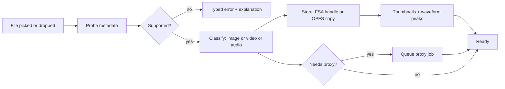
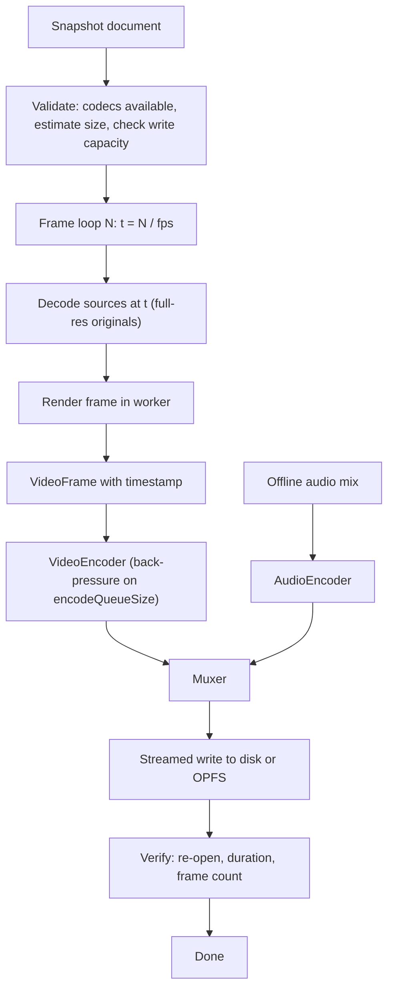

# Media processing pipeline

- **Status:** Draft for owner review (2026-11-17)
- **Related:** [system architecture](system-architecture.md), [ADR-0003](../adr/0003-video-io-and-codec-stack.md), [ADR-0007](../adr/0007-concurrency-and-export-pipeline.md), [spike results](../research/spike-results.md)

## 1. Import pipeline

- **Probe:** container and stream metadata via Mediabunny (video: codec, profile, resolution, fps, duration, keyframe interval estimate, audio streams;
  images: decode header via `createImageBitmap`, EXIF orientation). Check `VideoDecoder.isConfigSupported` for the exact codec string with both
  hardware and software preference and record which works.
- **Proxy rule (ASSET-5):** needs a proxy if resolution is above 1080p, keyframe interval is over 2 s, or only software decode is available.
  S1 showed software decode and 10 s GOPs miss the 150 ms seek target; S7 showed proxy generation at 7.3x realtime (1080p) and 2.5x (4K).
  Proxy = 960x540 H.264, 1 s GOP, AAC passthrough or re-encode, stored in OPFS. Original is used for export and for exact inspection.
- **Thumbnails and peaks:** low-priority analysis worker; results cached in OPFS keyed by asset ID + hash of probe data.
- **Large files:** never read whole into memory; stream via `Blob.slice`/file handle.

## 2. Video decode and preview
- **Decode scheduler** keeps, per active source, a decoder positioned in the right GOP and prefetches a configurable window ahead of the playhead.
- **Seeking:** find the previous keyframe, decode forward, discard until the target timestamp. With hardware decode and a 2 s GOP this measured p95 83 ms raw /
  130 ms via Mediabunny (target under 150 ms). Long GOPs and software decode are routed to proxies.
- **Frame cache:** holds **copies** (`ImageBitmap`, optionally GPU textures) in an LRU with a frame budget and a memory budget. `VideoFrame`s are closed immediately after copy.
  Rule from S1: the hardware decoder halts at about 8 held `VideoFrame`s, so no cache may hold them. Rule from S7: JS heap is not the health metric; sample process-wide memory.
- **Concurrency:** at most N simultaneously active decoders (initial N = 4, to be measured in the M5 spike); extra overlapping clips use proxies or lower-priority decode.
- **Clock:** audio is the master clock during playback. Video frames are chosen for the audio time; if late, drop video frames. Scrubbing runs without audio.

## 3. Compositing
- The renderer receives a document snapshot plus a timeline time and produces the frame: sources (cached frames/textures) → per-clip transform, crop, colour adjustments →
  effects → transitions (two inputs + progress) → overlays/text → output.
- Blend and colour maths use our own shader library validated against W3C formulas to within 2/255 per channel ([ADR-0004](../adr/0004-rendering-stack.md)).
- Text and subtitle clips are rasterised by Canvas 2D into textures, cached until the text/style changes.
- Colour space: sRGB, 8-bit, premultiplied alpha internally. Documented limitation for v1.

## 4. Audio
- **Preview:** Web Audio graph on the page thread. Per clip: `AudioBufferSourceNode` (or streamed decode) → clip gain (volume + fades) → track gain/mute/solo → master gain + meter.
  Decoded audio chunks are cached per source; long sources stream.
- **Speed:** playback rate change in v1 shifts pitch (documented). Pitch-preserving stretch is deferred because the common libraries are LGPL/GPL ([ADR-0011](../adr/0011-dependency-licence-policy.md)); a self-written WSOLA is a post-v1 option.
- **Export mix:** `OfflineAudioContext` (page thread; not available in workers) renders the full mix at the output sample rate in chunks; chunks go to the export worker for `AudioEncoder`.

## 5. Export pipeline

- **Deterministic:** frame N always maps to timestamp N/fps (or the rational equivalent for 29.97), independent of machine speed.
- **Back-pressure:** pause the frame loop when `encodeQueueSize` exceeds a threshold; bounded queues between all stages; every frame closed exactly once (leak counter in dev).
- **Encoder selection:** probe order hardware H.264 → software H.264 → VP9; user sees which will be used and a warning when only software is available (S4: software was 2.3x realtime but used far more CPU).
- **Segmented export:** long exports render in segments (GOP-aligned) so a failure resumes at the last completed segment. Not yet spiked; part of M7.
- **Cancel:** stop the frame loop → close encoders → `output.cancel()` → remove the partial file → release decoders → report `Cancelled`. Measured cleanup: under 10 ms in S4. Note: `writable.abort()` throws on the OPFS sink, so use `output.cancel()` then `removeEntry()`.
- **Failure taxonomy:** `UnsupportedCodec`, `EncoderError`, `DecodeFailed`, `OutOfMemory`/`QuotaExceeded`, `WriteFailed`, `Cancelled`. Each has a user message and a suggested fix (lower resolution, other codec, free space).
- **Background tabs:** browsers throttle hidden tabs. Export shows a "keep this tab visible" hint and uses worker-driven loops (not `requestAnimationFrame`); throttling behaviour is to be measured in M7.
- **Memory:** budget covers renderer, GPU process and workers; the export worker releases decoded frames immediately and does not accumulate.

## 6. Image pipeline
- **Decode:** `createImageBitmap` with `imageOrientation: from-image`; SVG via an `` (never inline); GIF first frame.
- **Working format:** 8-bit sRGB, premultiplied alpha, GPU textures, tile-based raster layers ([image editor](image-editor.md)).
- **Export:** render at target scale (tile by tile for large images) → `OffscreenCanvas.convertToBlob` (PNG/JPEG/WebP quality) → strip metadata (default) → write. AVIF later via a lazy-loaded WASM encoder.

## 7. Capability and fallback matrix
| Feature | Needs | Fallback |
|---|---|---|
| Hardware encode | `VideoEncoder.isConfigSupported` with prefer-hardware | Software encode with a warning |
| H.264/AAC MP4 export | H.264 + AAC encoders | WebM VP9/Opus, or message |
| Hardware decode | `VideoDecoder` hardware config | Software decode + proxy |
| In-place file editing and stream-to-disk | File System Access pickers (Chromium) | OPFS copy; export via Blob/download with size warning |
| Worker rendering | WebGL2 in `OffscreenCanvas` | Main-thread renderer |
| Reliable storage | Startup write-probe passes | Warn and limit project size |

## 8. Performance budgets (also in requirements)
Decode ≥ 2x realtime at 1080p; seek < 150 ms (GOP ≤ 2 s); preview 30 fps; export ≥ 1x realtime; per-decoder `VideoFrame` hold ≤ 6; proxy generation ≥ 1x realtime.
