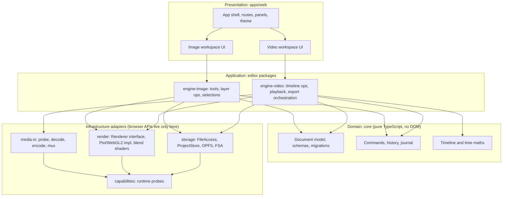

# System architecture

- **Status:** Draft for owner review (2026-11-17)
- **Related:** [ADRs](../adr/README.md), [media pipeline](media-pipeline.md), [image editor](image-editor.md), [video editor](video-editor.md),
  [project format](project-format.md), [security & privacy](security-privacy.md)

## 1. Goals and constraints
Local-first, single-user web app; no backend; static hosting. Two editors (image, video) share a shell, asset library and storage. Everything that
touches browser media APIs sits behind an interface so a future desktop engine can replace it ([ADR-0001](../adr/0001-web-first-platform.md)).
Measured platform limits from the [spikes](../research/spike-results.md) shape several choices below.

## 2. Layered view

Dependency rule: arrows only point downward. `core` imports nothing from the other packages. Adapters never import editors. Enforced by lint/dependency
tooling ([ADR-0010](../adr/0010-tooling-and-repo-structure.md)).

## 3. Threads and workers
| Context | Owns | Notes |
|---|---|---|
| **Main thread** | React UI, UI state (Zustand), document store and command dispatch, Web Audio graph, input handling, overlay canvases | Never decodes, encodes or does heavy pixel work. Per-frame UI (playhead, scrubbing) updates imperatively, not through React state ([ADR-0009](../adr/0009-ui-stack-and-theming.md)) |
| **Render worker** | WebGL2 context on a transferred `OffscreenCanvas`, texture/tile caches, compositor | Default for preview and export. Falls back to main-thread rendering behind the same `Renderer` interface if worker GL is unavailable. Preview-in-worker is to be confirmed in M1 (S3 proved export-style rendering in a worker, not interactive preview) |
| **Decode workers** (pool, capped) | One `VideoDecoder` per active source, demux, GOP-aware seeking | Output copies (`ImageBitmap`) into the frame cache, never long-held `VideoFrame`s ([ADR-0007](../adr/0007-concurrency-and-export-pipeline.md)) |
| **Export worker** | Offline render loop, `VideoEncoder`/`AudioEncoder`, muxing | Timestamp-driven, back-pressured. Audio is mixed on the page thread because `OfflineAudioContext` is unavailable in workers, then transferred |
| **Storage worker** | OPFS sync access handles, journal appends, tile spill | One writer per file ([ADR-0005](../adr/0005-storage-and-project-persistence.md)) |
| **Analysis worker** | Thumbnails, waveform peaks, proxy generation | Low priority; cancellable; yields to playback |

Workers talk through a typed message protocol (candidate implementation: Comlink). Transferable objects (`ImageBitmap`, `ArrayBuffer`, `OffscreenCanvas`) are
transferred, not copied. Every worker is supervised: crash or hang is detected, surfaced to the user, and the worker is restarted.

## 4. Core interfaces (contracts, not code)
| Interface | Responsibility | Implementations |
|---|---|---|
| `MediaEngine` | probe, createDecoder, createEncoder, mux, capability report | Web: WebCodecs + Mediabunny. Future: native FFmpeg engine |
| `Renderer` | build/update a scene from a document snapshot, render to canvas or `ImageBitmap`/`VideoFrame`, read back | Web: PixiJS v8 on WebGL2 (fallback: custom WebGL2). See [ADR-0004](../adr/0004-rendering-stack.md) |
| `ProjectStore` | load/save project, journal append and replay, checkpoint | OPFS (universal), FSA-backed (Chromium) |
| `FileAccess` | pick, open (handles), save-as, relink | FSA (Chromium), input-element/download (others) |
| `Capabilities` | async probe report, write-capacity probe | Browser probe module |
| `EffectProvider` / `AnalysisProvider` | plugin points for effects and analysis (AI, later) | None in v1 |

## 5. State ownership
| State | Lives in | Persisted | Notes |
|---|---|---|---|
| Document (layers/tracks/clips/properties) | `core` document store; plain, serialisable, validated data | Yes (project + journal) | Changed only by commands ([ADR-0006](../adr/0006-document-state-and-undo-redo.md)) |
| History (undo/redo) | `core` history, Immer patches | Journal only | Reconstructed from journal on recovery |
| UI state (selection, tool, zoom, panel layout, shortcuts) | Zustand | Settings subset in localStorage/IndexedDB | Never owns document data |
| Pixel/frame data | Engines: GPU textures, OPFS tiles, frame caches | Tiles and caches in OPFS | Referenced by ID from the document |
| Media files | User filesystem (FSA) or OPFS copy | Yes | Referenced, never embedded |

## 6. Main data flows
**Edit:** UI event → tool creates a command → document store applies it (patches + inverse) → history entry + journal append → new immutable snapshot → renderer reconciles
the scene → frame drawn. Continuous edits (drag, brush) coalesce into one history entry.

**Playback (video):** audio clock is master → playback engine requests frames for the current time → decode scheduler prefetches ahead (GOP-aware) → frame cache (copies) →
renderer composites layers/transitions → canvas. Late frames are dropped, never audio.

**Export:** snapshot the document → export worker iterates frame N ↔ exact timestamp N/fps → full-resolution decode → render → `VideoFrame` → encoder (back-pressured) → muxer → stream to
disk; audio mixed offline and encoded; verify output; clean up. Cancel/fail removes the partial file. Details in [media pipeline](media-pipeline.md).

**Recovery:** on start, detect an unclean session → load last checkpoint → replay journal → offer to restore.

## 7. Error handling and diagnostics
- Typed error taxonomy at every boundary (`UnsupportedCodec`, `DecodeFailed`, `OutOfMemory`, `QuotaExceeded`, `WriteFailed`, `Cancelled`, `InvalidProject`, `WorkerCrashed`).
  Errors carry a user message, a technical detail and a recovery hint; the UI never shows raw exceptions.
- Local diagnostic log (ring buffer, viewable and exportable) with counters: decode fps, render ms, queue depths, open frames, total process memory samples where available.
- Dev-only leak detectors for `VideoFrame`/`ImageBitmap` ownership and worker message backlogs.

## 8. Extensibility (AI and desktop)
- **AI:** optional modules implement `EffectProvider`/`AnalysisProvider`, are loaded lazily, never imported by `core` or the engines, and run in their own worker with explicit consent
  for model downloads ([ADR-0018](../adr/0018-ai-module-boundary.md)).
- **Desktop:** replace the infrastructure adapters (`MediaEngine`, `FileAccess`, `ProjectStore`) with native implementations; editors and UI are unchanged.

## 9. Known architectural risks
| Risk | Source | Plan |
|---|---|---|
| GPU-process memory growth | S7 | Soak spike in M5; memory budgets cover all processes |
| Multi-decoder concurrency limit | not spiked | Spike in M5; decoder pool with cap; proxies |
| Preview rendering in a worker | not spiked | Confirm in M1; main-thread fallback |
| Pixi blend/adjustment exactness | S3 | Own blend shader library; acceptance tests |
| Structural-edit undo latency | S5 | Normalised document shape; re-measure in M2 |
