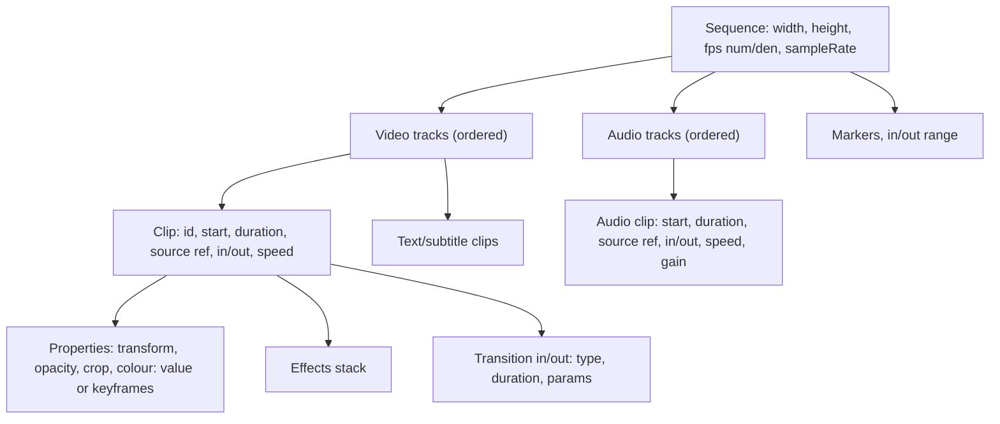

# Video editor architecture

- **Status:** Draft for owner review (2026-11-17)
- **Requirements:** VID-1 to VID-14, EXP-1 to EXP-8, PERF-2 to PERF-4, PERF-7, PERF-8. **Related:** [media pipeline](media-pipeline.md), [system architecture](system-architecture.md), [ADR-0003](../adr/0003-video-io-and-codec-stack.md), [ADR-0007](../adr/0007-concurrency-and-export-pipeline.md), [ADR-0014](../adr/0014-timeline-ui-rendering.md)

## 1. Scope (tier 2)
Multi-track timeline, trim/split/merge/ripple, overlays and PiP, transitions, constant speed, text and subtitles, audio volume/fades/waveforms, basic colour, keyframe-capable properties, proxies, export. Out of scope: multicam, nested sequences, motion graphics, pitch-preserving speed.

## 2. Time model
- Integer **microseconds** for all timeline and media timestamps (matches WebCodecs). Frame-based operations convert via the sequence's rational frame rate (e.g. 30000/1001) with explicit rounding rules, so 29.97 fps does not drift.
- Frame N ↔ time `round(N * 1e6 * den / num)`; the inverse uses floor of the frame interval. All conversions live in `core/time` with property tests.
- Audio sample positions derived from microseconds at the sequence sample rate (default 48 kHz).

## 3. Document model

- **Normalised storage:** `clips: Record<ClipId, Clip>`, `tracks: Record<TrackId, Track>`, each track holds an ordered `clipIds` list. Operations like split and ripple delete touch a bounded number of entries ([ADR-0006](../adr/0006-document-state-and-undo-redo.md) amendment; S5 showed array patches were the bottleneck).
- **Overlap rules:** clips on a track do not overlap (except via transitions, modelled as an overlap region owned by the transition). Overlays go on separate tracks.
- **Animatable property:** `value | Keyframe[]` with interpolation (linear, hold, bezier) from day one; v1 UI exposes only basic keyframing (VID-12).
- **Sources:** assets are referenced by ID with an optional proxy; the sequence never embeds media.

## 4. Engines
| Component | Responsibility | Runs in |
|---|---|---|
| Playback engine | Transport (play/pause/seek/shuttle), clock (audio master), frame requests, drop policy | Main thread (scheduler), audio on page |
| Decode scheduler | Per-source decoder lifecycle, GOP-aware seek and prefetch, concurrency cap | Decode workers |
| Frame cache | LRU of `ImageBitmap` copies and optional textures; frame and memory budgets | Render/decode workers |
| Compositor | Evaluate sequence at time t → layers → effects → transitions → output | Render worker ([ADR-0004](../adr/0004-rendering-stack.md)) |
| Audio engine | Web Audio graph, per-clip/track gain, fades, meter; offline mix for export | Main thread |
| Proxy manager | Decide, generate, cache, and switch proxies | Analysis worker |
| Analysis | Thumbnails, waveform peaks | Analysis worker |
| Export engine | Deterministic offline render, encode, mux, verify, cancel/resume | Export worker |
| Timeline ops | Pure functions: split, trim, ripple, move, snap, join, speed change | `engine-video` (testable without a browser) |

## 5. Playback specifics
- **Decode ahead:** target 0.5-1 s lookahead per active source; adapt to measured decode speed; software-decoded or long-GOP sources must use proxies.
- **Decoder concurrency:** each overlapping video clip at time t needs a decoder; hardware decoder instance limits are unknown (not spiked). The preview caps concurrent decoders at 4 (memory); additional clips show nothing. Spike S8 measured the real limit on Iris Xe: 16 concurrent 1080p30 decoders all ran (850 to 1,000 fps in total), so the cap is a memory choice, not a hardware limit.
- **Late frames:** drop video, never stall audio. Dropped-frame counter feeds diagnostics (PERF-2: under 2% on the reference project).
- **Scrubbing:** latest-wins request queue (superseded seeks cancelled); S7 measured scrub p95 96 ms at one request per 100 ms.
- **Memory:** frame cache stores copies; hold `VideoFrame`s only transiently (hard limit 6 per decoder). Budgets include GPU/process memory because S7 saw ~1 GB GPU growth in 90 s with balanced counters; a 30-minute soak test gates M5.

## 6. Effects, transitions, text
- **Per-clip:** transform (position, scale, rotation, anchor), opacity, crop, colour (brightness, contrast, saturation, temperature). Implemented as shader passes shared with the image editor's adjustment library.
- **Transitions:** cross-fade, dip to black/white, wipe, slide: shaders taking two textures and a progress value; duration adjustable; handles (extra media beyond the cut) required, with a warning when missing.
- **Text and subtitles:** text clips rasterised by Canvas 2D (shared with image text); SRT/VTT import creates subtitle clips on a subtitle track; burned in at export. Soft subtitle tracks in MP4 are post-v1.
- **Speed:** constant 0.25-4x. Video uses frame time mapping; audio resampled with playback rate change, so **pitch changes in v1** (documented in-UI). Pitch-preserving stretch is deferred (LGPL/GPL libraries; possible self-written WSOLA).

## 7. Audio engine
Clip → gain (volume + fade curves) → track bus (gain, mute, solo) → master (gain, limiter-free in v1, peak meter). Waveform peaks cached in OPFS. Export mix replicates the graph in an `OfflineAudioContext` so preview and export match.

## 8. Export
Follows the [media pipeline](media-pipeline.md): snapshot → deterministic frame loop → decode originals → render → encode (hardware, then software, then VP9) → mux → stream to disk → verify. Segmented and resumable. Presets for resolution, fps, bitrate. 4K export is best-effort and warns about memory.

## 9. Timeline UI rendering (summary)
Virtualised DOM clips for accessibility and token-based theming, canvas for ruler/waveforms/thumbnails, imperative playhead ([ADR-0014](../adr/0014-timeline-ui-rendering.md)). Snapping, zoom, selection, drag, trim handles are implemented in a headless interaction model in `engine-video` so they can be unit-tested.

## 10. Testing
Unit: time conversions, split/trim/ripple/join/snap invariants (property-based: no overlaps, durations preserved, undo round trip), speed mapping, transition overlap rules, keyframe interpolation.
Integration (browser): decode/seek accuracy on generated fixtures, frame cache leak counters, audio-clock sync, export round trip (duration, frame count, resolution, audio present), cancel clean-up. Soak: long playback with memory sampling.

## 11. Known limitations (v1)
1080p guaranteed, 4K best-effort via proxies; limited concurrent decoders (unmeasured); pitch changes with speed; sRGB only; no nested sequences; HEVC/AV1 depend on browser; export speed depends on hardware vs software encode; Safari/Firefox less tested.
