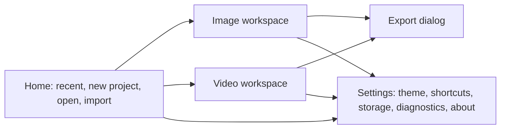

# UI/UX specification

- **Status:** Draft for owner review (2026-11-17)
- **Requirements:** PLAT-5/6, UX-1 to UX-5, A11Y-1 to A11Y-3. **Related:** [ADR-0009](../adr/0009-ui-stack-and-theming.md), [ADR-0013](../adr/0013-ui-primitives-react-aria.md), [ADR-0014](../adr/0014-timeline-ui-rendering.md)

## 1. Design principles
1. **Content first:** media is the star; chrome is quiet, neutral and dense but not cramped.
2. **Progressive disclosure:** simple defaults for beginners; advanced controls one click away; nothing hidden that a pro expects within two clicks.
3. **Predictable:** consistent panels, shortcuts and behaviours across image and video editors.
4. **Honest:** capability limits (no hardware encode, proxy in use, unsupported codec) are shown plainly with a fix, never silently degraded.
5. **Fast feedback:** continuous operations preview live; long operations show progress and are cancellable.
6. **Accessible:** keyboard-operable, readable, motion-safe.

References for workflow ideas (not interface copies): Photopea and Figma (panels, layer lists), DaVinci Resolve and CapCut (timeline, inspector), Canva (templates, simplicity).

## 2. Information architecture


## 3. Workspace layouts
Fixed, resizable, collapsible panels in v1 (no free docking). Panel sizes persist per workspace.

**Image workspace**
```
┌──────────────────────────────────────────────────────────────────────┐
│ Top bar: project name  | undo redo | zoom % | theme | Export         │
├────┬─────────────────────────────────────────────┬──────────────────┤
│Tool│                                             │ Properties        │
│rail│              Canvas (pan / zoom)            │ (context: tool,   │
│    │                                             │  layer, text...)  │
│    │                                             ├──────────────────┤
│    │                                             │ Layers            │
│    │                                             │ Adjustments       │
├────┴─────────────────────────────────────────────┴──────────────────┤
│ Status bar: size, zoom, cursor px, memory/limits indicator           │
└──────────────────────────────────────────────────────────────────────┘
```
**Video workspace**
```
┌──────────────────────────────────────────────────────────────────────┐
│ Top bar: project | undo redo | sequence settings | theme | Export    │
├──────────────┬──────────────────────────────┬───────────────────────┤
│ Library      │         Preview               │ Inspector              │
│ (assets,     │   (transport, safe areas)     │ (clip / track /        │
│ text, trans.)│                               │  transition / audio)   │
├──────────────┴──────────────────────────────┴───────────────────────┤
│ Timeline: ruler, tool strip, video tracks, audio tracks, playhead    │
└──────────────────────────────────────────────────────────────────────┘
```
Narrow widths (1024 px): library and inspector become tabs in one side panel.

## 4. Key surfaces and behaviour
| Surface | Behaviour |
|---|---|
| **Home** | Recent projects (thumbnail, type, modified), "New image", "New video", "Open", drag files to start; recovery banner if unsaved changes were found |
| **Canvas (image)** | Pan (space+drag, middle mouse), zoom (wheel, pinch, shortcuts), rulers/guides/grid optional, selection outline, transform handles, brush cursor reflecting size/hardness |
| **Layers panel** | Tree with drag-reorder, visibility/lock toggles, thumbnails, blend/opacity, mask indicator, multi-select, context menu |
| **Properties/Inspector** | Context-sensitive sections (collapsible): transform, appearance, text, effects, colour, audio; numeric fields with scrub-drag and units; reset buttons |
| **Timeline** | Virtualised clips, snapping, zoom to fit, track headers (lock, mute, solo, height), trim handles, transition handles, drop indicators, waveform/thumbnail strips, markers; imperative playhead ([ADR-0014](../adr/0014-timeline-ui-rendering.md)) |
| **Preview** | Transport, current time/frames, quality (full/half/quarter), proxy indicator, dropped-frame indicator in diagnostics |
| **Export dialog** | Preset picker, advanced (resolution, fps, bitrate, codec), estimated size/time, capability warnings, destination, progress with cancel, verified-output summary |
| **Capability screen** | Plain-language explanation of what is unavailable and how to fix (update/switch browser), shown at start for tier 3 and as inline notices for tier 2 limits |
| **Settings** | Theme, shortcuts editor with conflict detection, storage usage + clear data, diagnostics log export, version info |

## 5. Beginner and advanced paths
- **Beginner:** Home → drop media → guided empty states ("Drag a clip here") → "Quick actions" row (trim, add text, add music, export) → export preset "Web 1080p". Tooltips show names and shortcuts.
- **Advanced:** inspector sections expanded by default via setting; full shortcut set; numeric entry; layer/clip multi-selection; custom export settings.
- Onboarding is a dismissible hint set (not a blocking tour).

## 6. Keyboard shortcuts (defaults, all rebindable)
| Action | Default |
|---|---|
| Undo / Redo | Ctrl/Cmd+Z / Ctrl/Cmd+Shift+Z (and Ctrl+Y on Windows) |
| Copy / Cut / Paste / Duplicate | Ctrl/Cmd+C / X / V / D |
| Select all / Deselect | Ctrl/Cmd+A / Ctrl/Cmd+Shift+A |
| Save / Export | Ctrl/Cmd+S / Ctrl/Cmd+Shift+E |
| Tools (image) | V move, M marquee, L lasso, B brush, E eraser, T text, U shape, C crop, I eyedropper |
| Zoom | Ctrl/Cmd +/-, 0 fit, 1 actual size; Space+drag pan |
| Play/pause | Space |
| Shuttle | J reverse, K stop, L forward |
| Frame step | Left / Right arrows; Shift = 10 frames |
| Split at playhead | S |
| Ripple delete | Shift+Delete |
| In / Out | I / O |
| Add marker | M |
| Timeline zoom | + / - ; Shift+Z fit |
| Toggle snapping | N |
Conflict detection and a searchable shortcut reference (Ctrl/Cmd+/) are part of UX-1. Shortcuts never fire while typing in an input.

## 7. Theming and design tokens
- One `theme.css` with Tailwind v4 `@theme`: semantic colour tokens (`surface`, `surface-raised`, `surface-sunken`, `border`, `text`, `text-muted`, `accent`, `accent-contrast`, `success`, `warning`, `danger`, `focus-ring`, `selection`, `track-video`, `track-audio`), spacing, radius, type scale, shadows, z-index layers, motion durations.
- Dark (default) and light via a `data-theme` attribute re-pointing the variables; OKLCH colour values; **no raw colours in components** (lint rule).
- **Contrast:** text 4.5:1 minimum, UI components 3:1, verified by automated token checks in CI for both themes.
- **Canvas neutrality:** the image canvas and preview background use neutral greys independent of the accent colour to avoid colour bias while editing.

## 8. Responsiveness
Supported widths from 1024 px: panels collapse to icons or tabs, timeline remains full width. Below 1024 px: show a clear "desktop-sized window required" message (mobile out of scope). Touch is not designed for in v1, though pointer events keep tablets with styluses viable for brush work.

## 9. Accessibility
- WCAG 2.2 AA targets. Visible focus ring on every interactive element; logical tab order; roving tabindex in lists/toolbars.
- Accessible primitives for menus, dialogs, tabs, sliders, tooltips, comboboxes ([ADR-0013](../adr/0013-ui-primitives-react-aria.md)).
- Canvas surfaces are not directly readable by assistive tech: provide labelled layer/clip lists, keyboard commands for every action (nudge, trim, split, move between tracks), and live-region announcements for key state changes (tool changed, export progress).
- Respect `prefers-reduced-motion` and `prefers-color-scheme` (default theme follows OS, overridable).
- Automated checks (axe) on panels/dialogs; manual keyboard pass per milestone.

## 10. States and messaging
Every surface defines: empty, loading, error and "feature unavailable" states. Errors use the typed taxonomy: plain message + what happened + one suggested action. Destructive actions are undoable instead of confirmed wherever possible; irreversible ones (delete project, clear data) require explicit confirmation naming what is lost.

## 11. Component inventory (design system, `packages/ui`)
Button, IconButton, Toggle, Checkbox, Radio, Select, ComboBox, Slider (with numeric scrub), NumberField, ColorPicker, Tabs, Menu/ContextMenu, Dialog, Popover, Tooltip, Toast, Progress, Panel (resizable/collapsible), Tree (layers), List (assets), Toolbar, ShortcutHint, EmptyState, ErrorState, Skeleton. All consume tokens only; each has a documented a11y contract and tests.

## 12. Open UX items
Final tool-rail icon set (needs a permissively licensed set, e.g. Lucide ISC); onboarding copy; empty-state illustrations (CC0 or original); export preset names and defaults.
